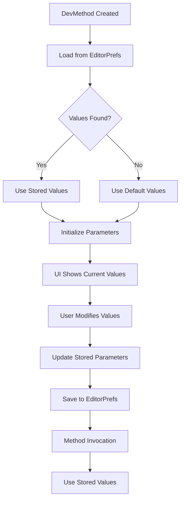

# Enhanced Parameter System

## Overview

The DevMenu tool now features an **enhanced parameter system** that stores parameter values directly within each `DevMethod` instance. This provides a more intuitive and powerful way to manage debug method parameters.

## Key Features

### 🎯 **Parameter Storage Per Method**
- Each `DevMethod` stores its own parameter values
- Parameters persist between Unity sessions via EditorPrefs
- Automatic fallback to default values when no stored values exist

### 🔄 **Reset Functionality**
- "Reset to Defaults" button in the UI for each method
- Restores all parameters to their original default values
- Updates UI fields immediately after reset

### 💾 **Automatic Persistence**
- Parameter values are automatically saved when changed
- Values are loaded when the method is first accessed
- Seamless integration with existing EditorPrefs system

## How It Works

### **Parameter Flow**



### **Button Click vs Hotkey**

| Action | Parameter Source | Behavior |
|--------|------------------|----------|
| **UI Button** | Current UI field values | Updates stored parameters, then invokes |
| **Hotkey** | Stored parameter values | Uses last-saved values, no UI interaction |

## Implementation Details

### **Enhanced DevMethod Interface**

```csharp
public interface IDevMethod : IDevMethodInfo, IDevMethodExecutor
{
    // Parameter management methods
    object[] GetCurrentParameters();
    void SetParameter(int index, object value);
    void ResetToDefaults();
    void SaveToEditorPrefs();
    bool LoadFromEditorPrefs();
}
```

### **Key Methods**

- **`GetCurrentParameters()`**: Returns current parameter values (stored or defaults)
- **`SetParameter(index, value)`**: Updates a specific parameter and saves it
- **`ResetToDefaults()`**: Restores all parameters to their original defaults
- **`SaveToEditorPrefs()`**: Persists current values to EditorPrefs
- **`LoadFromEditorPrefs()`**: Loads values from EditorPrefs (returns success status)

### **Simplified MethodInvoker**

The `MethodInvoker` is now much simpler:

```csharp
public void Invoke(IDevMethod method, object[] suppliedArgs = null)
{
    // If suppliedArgs is provided (from UI), update the method's stored parameters
    if (suppliedArgs != null)
    {
        for (int i = 0; i < suppliedArgs.Length && i < method.Parameters.Length; i++)
        {
            method.SetParameter(i, suppliedArgs[i]);
        }
    }
    
    // Invoke with current parameters (either updated from UI or existing stored values)
    method.Invoke();
}
```

## Benefits

### ✅ **Advantages**

1. **Cleaner Architecture**
   - Parameter logic is contained within `DevMethod`
   - `MethodInvoker` is simplified and focused
   - Better separation of concerns

2. **Better User Experience**
   - Parameters "remember" their last values
   - Reset functionality is obvious and accessible
   - UI always shows current parameter state

3. **More Intuitive**
   - Each method owns its parameter state
   - No complex parameter resolution logic
   - Clear relationship between UI and stored values

4. **Enhanced Testing**
   - Can test parameter storage independently
   - Mock methods have predictable parameter states
   - Easier to verify parameter persistence

## Usage Examples

### **Basic Usage**

```csharp
[DevMenu("Cheats", KeyCode.G)]
private void AddGold(int amount = 100)
{
    Debug.Log($"Added {amount} gold!");
}
```

**Behavior:**
- UI shows current value (100 initially, or last-saved value)
- User can modify the value in the UI
- Hotkey uses the stored value
- "Reset to Defaults" restores to 100

### **Multiple Parameters**

```csharp
[DevMenu("Player", KeyCode.H)]
private void SetPlayerStats(int health = 100, float speed = 5.0f, bool invincible = false)
{
    Debug.Log($"Set stats: Health={health}, Speed={speed}, Invincible={invincible}");
}
```

**Behavior:**
- All three parameters are stored independently
- Each parameter remembers its last value
- Reset restores all to defaults
- Hotkey uses all stored values

### **No Parameters**

```csharp
[DevMenu("Debug", KeyCode.J)]
private void LogDebugInfo()
{
    Debug.Log("Debug info logged");
}
```

**Behavior:**
- No parameter storage needed
- Works exactly as before
- No UI changes for parameterless methods

## Migration from Previous System

The enhanced system is **backward compatible**:

- ✅ Existing code works without changes
- ✅ Parameter persistence still works
- ✅ UI behavior is improved but familiar
- ✅ Hotkey behavior is more predictable

## Testing

The enhanced system includes comprehensive tests:

```csharp
[Test]
public void GetCurrentParameters_ShouldReturnDefaultValues_WhenNoParametersSet()
{
    var parameters = _devMethod.GetCurrentParameters();
    Assert.That(parameters[0], Is.EqualTo(100)); // Default value
}

[Test]
public void SetParameter_ShouldUpdateParameterValue()
{
    _devMethod.SetParameter(0, 500);
    var parameters = _devMethod.GetCurrentParameters();
    Assert.That(parameters[0], Is.EqualTo(500));
}
```

## Future Enhancements

Potential improvements for the enhanced system:

1. **Parameter Validation**: Add validation rules to parameters
2. **Parameter Presets**: Save multiple parameter configurations
3. **Parameter Change Events**: Notify when parameters change
4. **Parameter History**: Track parameter value changes over time
5. **Parameter Export/Import**: Share parameter configurations

## Conclusion

The enhanced parameter system provides a more intuitive, maintainable, and powerful way to manage debug method parameters. It improves both the developer experience and the tool's architecture while maintaining full backward compatibility. 