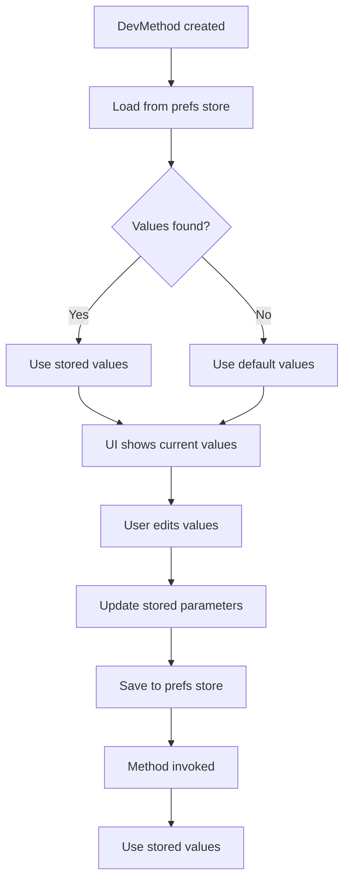

# DevMenu Tool

An in-game debug menu for Unity. Mark any `MonoBehaviour` method with `[DevMenu]` and it shows up
in a menu with editable parameters, an optional hotkey, and values that persist between sessions.
Built on attributes, reflection, and UI Toolkit.

## Features

- **One attribute**: `[DevMenu]` turns a method into a menu entry. No registration code.
- **Hotkeys**: bind a key per method, and rebind it from the editor window.
- **Typed parameters**: `int`, `float`, `bool`, `string`, and enum parameters get matching input fields.
- **Persistent values**: parameter values and hotkey rebinds are remembered across sessions.
- **Declarative validation**: constrain parameters with attributes such as `[ParameterRange]`.
- **Editor window and in-game panel**: use the menu from the editor, or add it to your game's UI.
- **Player-build safe**: editor code lives in a separate assembly and is stripped from builds.

## Requirements

- Unity 2021.3 or newer.
- Hotkeys read input through the legacy Input Manager. Set **Project Settings > Player > Active Input
  Handling** to *Input Manager (Old)* or *Both*. The menu itself works with either setting.

## Installation

In the Package Manager, choose **+ > Add package from git URL** and enter:

```
https://github.com/routaz/DevMenuTool.git?path=/com.routaz.devmenu
```

To work from a local clone instead, choose **+ > Add package from disk** and select
`com.routaz.devmenu/package.json`.

### Try the sample

In the Package Manager, select this package and choose **Samples > DevMenu Sample > Import**. It adds
a single `DevMenuSample` component. Drop it on an empty GameObject to see actions, typed parameters,
validation, and change events.

## Quick Start

```csharp
using DevMenuTool.Core.Attributes;
using UnityEngine;

public class GameDebugger : MonoBehaviour
{
    [DevMenu(KeyCode.G, "Cheats")]
    private void AddGold(int amount = 100)
    {
        Debug.Log($"Added {amount} gold!");
    }

    [DevMenu(KeyCode.H, "Player")]
    private void SetPlayerHealth(int health = 100, bool invincible = false)
    {
        Debug.Log($"Set health to {health}, invincible: {invincible}");
    }
}
```

Both methods now appear in the menu under their group. Press **G** in Play Mode to add gold using
the last value entered in the menu.

### Opening the menu

- **Editor**: choose **DevMenu > Open Dev Menu** from the menu bar. In Edit Mode you can browse
  methods, edit parameter values, and rebind hotkeys. **Run** is enabled in Play Mode. The window
  rescans after script recompiles and when entering or exiting Play Mode. Use the toolbar
  **Refresh** button after loading scenes or spawning objects at runtime.
- **In Play Mode**: hotkeys work with no setup. A listener is added automatically when the scene loads.
- **In-game panel**: add a `UIDocument` and the `DevMenuUIController` component. The UXML must
  contain a `ScrollView` named `method-scroll`.

### Menu-only methods

Pass only a group name, or `KeyCode.None`, to list a method without binding a hotkey:

```csharp
[DevMenu("World")]
private void RespawnEnemies() { }

[DevMenu(KeyCode.None, "World")]
private void ClearDebris() { }
```

### Which objects are scanned

`[DevMenu]` methods are found on every `MonoBehaviour` in the loaded scenes, including inactive
objects, `DontDestroyOnLoad` objects, and objects hidden with `HideFlags` such as `HideAndDontSave`.
Prefabs and other assets are not scanned. Only instance methods are supported, public or private.

## Parameters

Each method keeps its own parameter values:

1. **Stored per method**: each `DevMethod` holds the current value of every parameter.
2. **Saved automatically**: values are written to `EditorPrefs` in the editor and to `PlayerPrefs` in
   player builds. Hotkey rebinds use the same store.
3. **Defaults as fallback**: a method with no saved values starts from its C# default parameter values.
4. **Reset**: each method has a button that restores its default values.

### Parameter flow



### Run button vs. hotkey

| Action | Parameter source | Behavior |
|--------|------------------|----------|
| **Run button** | Current field values | Updates the stored values, then invokes |
| **Hotkey** | Stored values | Invokes with the last saved values |

### Validation

Validation is declarative. Annotate parameters with validation attributes and the menu applies them
when the method is discovered, so the method body needs no guard clauses:

```csharp
using DevMenuTool.Core.Attributes;

[DevMenu(KeyCode.G, "Cheats")]
private void AddGold([ParameterRange(0, 9999)] int amount = 100)
{
    PlayerGold += amount;
}

[DevMenu(KeyCode.N, "Player")]
private void SetPlayerName([StringValidation(minLength: 2, maxLength: 16)] string name = "Hero")
{
    playerName = name;
}
```

| Attribute | Applies to | Rule |
|-----------|------------|------|
| `[ParameterRange(min, max, inclusive = true)]` | numeric | Value must fall within the range |
| `[StringValidation(minLength, maxLength, pattern, allowEmpty)]` | string | Length, regex, and emptiness rules |
| `[Required]` | string | Value must not be null or empty |

An invalid entry is rejected and the last valid value is kept. The parameter is never silently reset
to its default. To add your own rule, implement `IParameterValidator` and a matching
`ParameterValidationAttribute`.

### Enum parameters

Enums get a dropdown:

```csharp
public enum GameState { Menu, Playing, Paused, GameOver }

[DevMenu(KeyCode.J, "Game")]
private void SetGameState(GameState state = GameState.Playing)
{
    currentGameState = state;
}
```

### Custom parameter types

Parsing and formatting are handled by `IParameterHandler` implementations. To support another type,
implement the interface:

```csharp
public class Vector3ParameterHandler : IParameterHandler
{
    public bool CanHandle(Type parameterType) => parameterType == typeof(Vector3);

    public object Parse(string input, Type targetType)
    {
        var parts = input.Split(',');
        return new Vector3(float.Parse(parts[0]), float.Parse(parts[1]), float.Parse(parts[2]));
    }

    public string ToString(object value)
    {
        var vector = (Vector3)value;
        return $"{vector.x},{vector.y},{vector.z}";
    }
}
```

> **Note:** there is no runtime registration API yet. Add your handler to the list in the
> `ParameterHandlerRegistry` constructor to enable it.

## Architecture

### Core components

- **`DevMethod`**: a discovered method together with its stored parameter values.
- **`MethodScanner`**: finds methods marked with `[DevMenu]`.
- **`MethodInvoker`**: invokes a method, resolving each parameter value.
- **`UIBuilder`**: builds the UI for each method.
- **`DevMenuContainer`**: composition root that creates and wires the shared services.

### Design

- **Factory**: `DevMethodFactory` creates `DevMethod` instances and wires their collaborators.
- **Strategy**: `ParameterHandlerRegistry` selects an `IParameterHandler` per parameter type.
- **Dependency injection**: `DevMethod` receives its collaborators (`IParameterManager`,
  `IParameterValidatorManager`, `IParameterEventManager`, `IParameterHandlerRegistry`) through its
  constructor. `DevMenuContainer` wires them together.
- **Interface segregation**: `IDevMethod` is composed from focused role interfaces (`IDevMethodInfo`,
  `IDevMethodExecutor`, `IParameterManager`, `IParameterValidatorManager`, `IParameterChangeNotifier`).

### Assemblies

- **`DevMenuTool`** (all platforms): core, runtime, UI, and persistence. It has no unguarded
  `UnityEditor` references, so it compiles into player builds.
- **`DevMenuTool.Editor`** (Editor only): the **DevMenu > Open Dev Menu** window. Unity strips it from
  player builds.

### Package layout

```
com.routaz.devmenu/
├── Core/                     # Attributes, interfaces, DevMethod, scanning, validation
├── Runtime/
│   ├── Handlers/             # Parameter type handlers
│   ├── Persistence/          # Parameter and hotkey storage (EditorPrefs / PlayerPrefs)
│   ├── MethodInvoker.cs
│   └── DevMenuHotkeyListener.cs
├── UI/                       # UI Toolkit builder, controller, UXML and USS
├── Editor/                   # Editor window (DevMenuTool.Editor assembly)
└── Samples~/DevMenuSample/   # Importable sample
```

## Testing

Tests are not shipped with the package, so projects that install it do not pull in test code or NUnit.
They live in the development project at `DevMenuTool/Assets/Tests/`. Open that project and run them
from **Window > General > Test Runner**.

## License

MIT. See [LICENSE](LICENSE.md).
