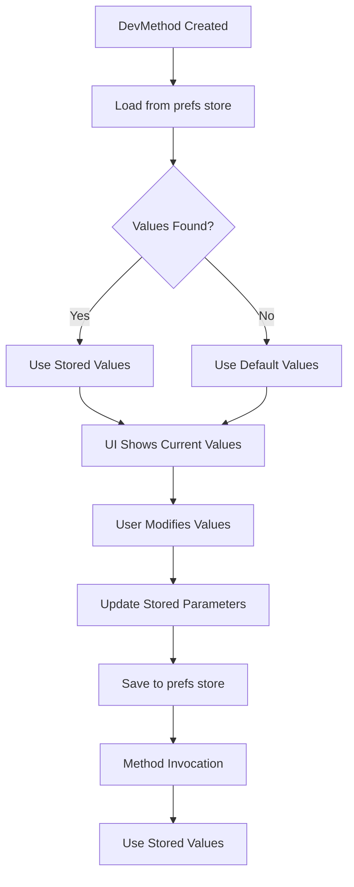

# DevMenu Tool - Enhanced Unity Debug Menu System

Modular in-game debug menu system for Unity that uses attributes, reflection, and UI Toolkit to create developer-friendly debug commands.

### **Core Features**
- **Attribute-Based**: Simple `[DevMenu]` attribute to mark debug methods
- **Hotkey Support**: Assign keyboard shortcuts to debug methods
- **UI Toolkit Integration**: Modern, responsive UI built with UI Toolkit
- **Parameter Support**: Full support for all parameter types (int, float, bool, enum, string)
- **Editor Integration**: Works in both Play Mode and Edit Mode
- **Project Agnostic**: Designed as a Unity package for easy distribution

## 📦 Installation

1. **Import into Unity** via Package Manager (`Add package from disk…` and pick this package's `package.json`).
2. **Mark methods** with the `[DevMenu]` attribute on any `MonoBehaviour` in your scene.
3. **Use it:**
   - In the **editor**, open `DevMenu > Open Dev Menu` from the menu bar.
   - In **Play Mode**, hotkeys work automatically — a listener is injected on start, no setup required.
   - For an **in-game UI panel**, add a `UIDocument` plus the `DevMenuUIController` component (the UXML needs a `ScrollView` named `method-scroll`).

### **Try the sample**

In the Package Manager, select this package and click **Samples > DevMenu Sample > Import**. It adds a single `DevMenuSample` MonoBehaviour you can drop on an empty GameObject to see actions, typed parameters, validation, and change events in action.

## 🎯 Quick Start

### **Basic Usage**

```csharp
using DevMenuTool.Core.Attributes;
using UnityEngine;

public class GameDebugger : MonoBehaviour
{
    [DevMenu(KeyCode.G, "Cheats")]
    private void AddGold(int amount = 100)
    {
        Debug.Log($"Added {amount} gold!");
        // This method will appear in the DevMenu with a hotkey
    }

    [DevMenu(KeyCode.H, "Player")]
    private void SetPlayerHealth(int health = 100, bool invincible = false)
    {
        Debug.Log($"Set health to {health}, invincible: {invincible}");
        // Parameters are stored and remembered between sessions
    }
}
```

### **Opening the Menu**

- **Runtime**: Press the configured hotkey or use the UI
- **Editor**: Go to `DevMenu > Open Dev Menu` in the menu bar. The window rescans automatically
  after script recompiles and when entering or exiting Play Mode; use the toolbar **Refresh** button
  after loading scenes or spawning objects at runtime.

### **Menu-only methods (no hotkey)**

Pass only a group name, or `KeyCode.None`, to list a method in the menu without binding a hotkey:

```csharp
[DevMenu("World")]                 // menu-only
private void RespawnEnemies() { }

[DevMenu(KeyCode.None, "World")]    // equivalent
private void ClearDebris() { }
```

### **Which objects are scanned**

`[DevMenu]` methods are discovered on every `MonoBehaviour` in the loaded scenes, including inactive
objects, `DontDestroyOnLoad` objects, and objects hidden with `HideFlags` such as `HideAndDontSave`.
Prefabs and other assets are not scanned. Only instance methods are supported.

## Enhanced Parameter System

1. **Parameter Storage**: Each `DevMethod` stores its own parameter values
2. **Automatic Persistence**: Values are saved automatically while playing — to `EditorPrefs` in the
   editor and to `PlayerPrefs` in player builds (hotkey rebinds use the same store)
3. **Smart Resolution**: UI updates stored values, hotkeys use stored values
4. **Reset Functionality**: Easy reset to default values

### **Parameter Flow**



### **Button Click vs Hotkey**

| Action | Parameter Source | Behavior |
|--------|------------------|----------|
| **UI Button** | Current UI field values | Updates stored parameters, then invokes |
| **Hotkey** | Stored parameter values | Uses last-saved values, no UI interaction |

## Usage Examples

### **Basic Debug Methods**

```csharp
[DevMenu(KeyCode.F1, "Debug")]
private void LogPlayerPosition()
{
    var player = GameObject.FindGameObjectWithTag("Player");
    if (player != null)
        Debug.Log($"Player position: {player.transform.position}");
}

[DevMenu(KeyCode.F2, "Debug")]
private void ShowGameStats()
{
    Debug.Log($"FPS: {1.0f / Time.deltaTime:F1}");
    Debug.Log($"Memory: {System.GC.GetTotalMemory(false) / 1024 / 1024}MB");
}
```

### **Parameterized Methods**

```csharp
[DevMenu(KeyCode.G, "Cheats")]
private void AddGold(int amount = 100)
{
    // amount will be stored and remembered
    PlayerGold += amount;
    Debug.Log($"Added {amount} gold! Total: {PlayerGold}");
}

[DevMenu(KeyCode.H, "Player")]
private void SetPlayerStats(int health = 100, float speed = 5.0f, bool invincible = false)
{
    // All parameters are stored independently
    playerHealth = health;
    playerSpeed = speed;
    playerInvincible = invincible;
    Debug.Log($"Set stats: Health={health}, Speed={speed}, Invincible={invincible}");
}
```

### **Enum Parameters**

```csharp
public enum GameState { Menu, Playing, Paused, GameOver }

[DevMenu(KeyCode.J, "Game")]
private void SetGameState(GameState state = GameState.Playing)
{
    currentGameState = state;
    Debug.Log($"Game state set to: {state}");
}
```

## Architecture

The DevMenu tool follows **SOLID principles** and **Clean Code** practices:

### **Core Components**

- **`DevMethod`**: Represents a debug method with parameter storage
- **`MethodScanner`**: Discovers methods with `[DevMenu]` attributes
- **`MethodInvoker`**: Handles method invocation with parameter resolution
- **`UIBuilder`**: Creates UI elements for method interaction
- **`DevMenuContainer`**: Composition root that wires and exposes the shared services

### **Design Patterns**

- **Factory Pattern**: `DevMethodFactory` creates `DevMethod` instances and wires their collaborators
- **Strategy Pattern**: `ParameterHandlerRegistry` handles different parameter types
- **Dependency Injection**: collaborators (`IParameterManager`, `IParameterValidatorManager`, `IParameterEventManager`, `IParameterHandlerRegistry`) are passed in through constructors; `DevMenuContainer` is the composition root that wires them together

### **Assemblies**

- **`DevMenuTool`** (all platforms): core, runtime, UI, and persistence. Contains no unguarded
  `UnityEditor` references, so it compiles into player builds.
- **`DevMenuTool.Editor`** (Editor platform only): the `DevMenu > Open Dev Menu` window. It is
  stripped from player builds automatically.

### **SOLID Notes**

- **Interface Segregation**: `IDevMethod` is composed from focused role interfaces (`IDevMethodInfo`, `IDevMethodExecutor`, `IParameterManager`, `IParameterValidatorManager`, `IParameterChangeNotifier`) rather than a single fat interface.
- **Dependency Inversion**: `DevMethod` depends on collaborator abstractions injected via its constructor instead of `new`-ing concretes, and parameter handling is resolved through the `IParameterHandlerRegistry` abstraction instead of a static lookup.

## Testing

Tests are not shipped with the package. They live in the development project (`DevMenuTool/Assets/Tests/`) so consumers stay clean of test code and NUnit references. To run them, open the development project and use `Window > General > Test Runner`.

## 📁 Project Structure

```
com.routaz.devmenu/
├── Core/                    # Core interfaces and implementations
│   ├── Interfaces/         # Interface definitions
│   ├── DevMethod.cs       # Enhanced DevMethod with parameter storage
│   ├── MethodScanner.cs   # Method discovery
│   └── DevMenuContainer.cs # Composition root
├── Runtime/                # Runtime functionality
│   ├── MethodInvoker.cs   # Method invocation
│   ├── Handlers/          # Parameter type handlers
│   ├── Persistence/       # Prefs-backed parameter & hotkey storage (EditorPrefs / PlayerPrefs)
│   └── DevMenuHotkeyListener.cs
├── UI/                     # UI Toolkit components
│   ├── UIBuilder.cs       # UI construction
│   └── DevMenuUIController.cs
├── Editor/                 # Editor-only assembly (DevMenuTool.Editor.asmdef)
│   └── DevMenuEditorWindow.cs
└── Samples~/               # Importable sample (via Package Manager)
    └── DevMenuSample/
        └── DevMenuSample.cs
```
## Advanced Features

### **Custom Parameter Types**

Parameter parsing/formatting is handled by `IParameterHandler` strategies. The built-in set
covers string, numeric, bool, and enum types. To support an additional type, implement
`IParameterHandler`:

```csharp
public class Vector3ParameterHandler : IParameterHandler
{
    public bool CanHandle(Type parameterType) => parameterType == typeof(Vector3);

    public object Parse(string input, Type targetType)
    {
        // Parse "x,y,z" format
        var parts = input.Split(',');
        return new Vector3(float.Parse(parts[0]), float.Parse(parts[1]), float.Parse(parts[2]));
    }

    public string ToString(object value)
    {
        var vector = (Vector3)value;
        return $"{vector.x},{vector.y},{vector.z}";
    }
}
```

> **Note:** handlers are currently registered in the `ParameterHandlerRegistry` constructor.
> Add your handler to that list to enable it — there is no runtime registration API yet.

### **Parameter Validation**

Validation is **declarative**: annotate parameters with validation attributes and the
DevMenu wires them up automatically when the method is discovered. There is no need to
hand-write guard clauses inside the method body.

```csharp
using DevMenuTool.Core.Attributes;

[DevMenu(KeyCode.G, "Cheats")]
private void AddGold([ParameterRange(0, 9999)] int amount = 100)
{
    // Only reached with a valid amount; no manual checks required.
    PlayerGold += amount;
    Debug.Log($"Added {amount} gold!");
}

[DevMenu(KeyCode.N, "Player")]
private void SetPlayerName([StringValidation(minLength: 2, maxLength: 16)] string name = "Hero")
{
    playerName = name;
}
```

Built-in attributes:

| Attribute | Applies to | Purpose |
|-----------|------------|---------|
| `[ParameterRange(min, max, inclusive = true)]` | numeric | Value must fall within the range |
| `[StringValidation(minLength, maxLength, pattern, allowEmpty)]` | string | Length / regex / emptiness rules |
| `[Required]` | string | Value must be non-null and non-empty |

When an entered value fails validation the edit is **rejected** and the last valid value is
kept — the parameter is never silently overwritten with the default. Add your own rule by
implementing `IParameterValidator` and a matching `ParameterValidationAttribute`.

## 📄 License

This project is licensed under the MIT License - see the [LICENSE](LICENSE.md) file for details.

**Made with ❤️ for Unity developers**
